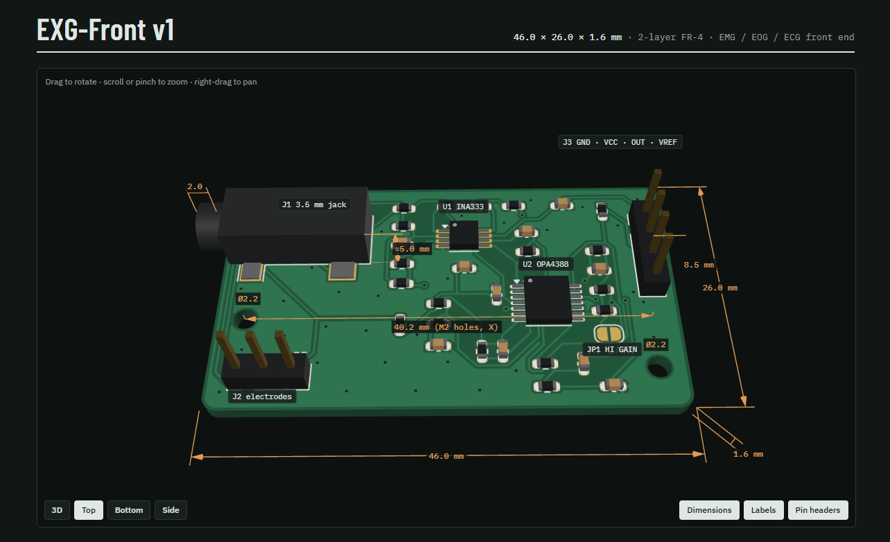
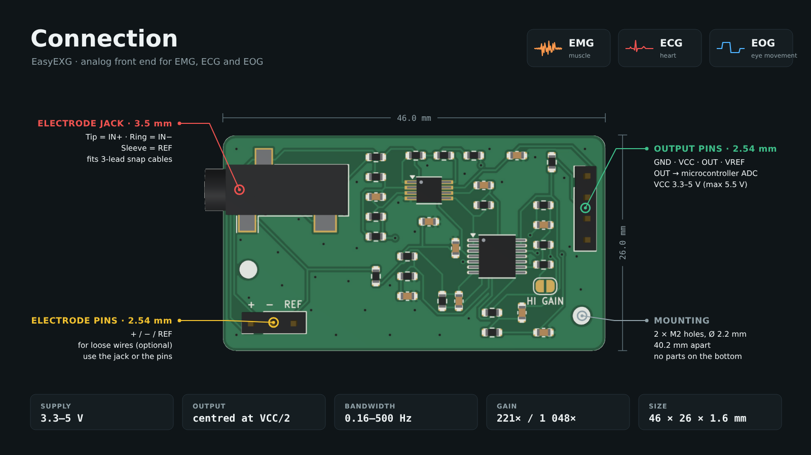
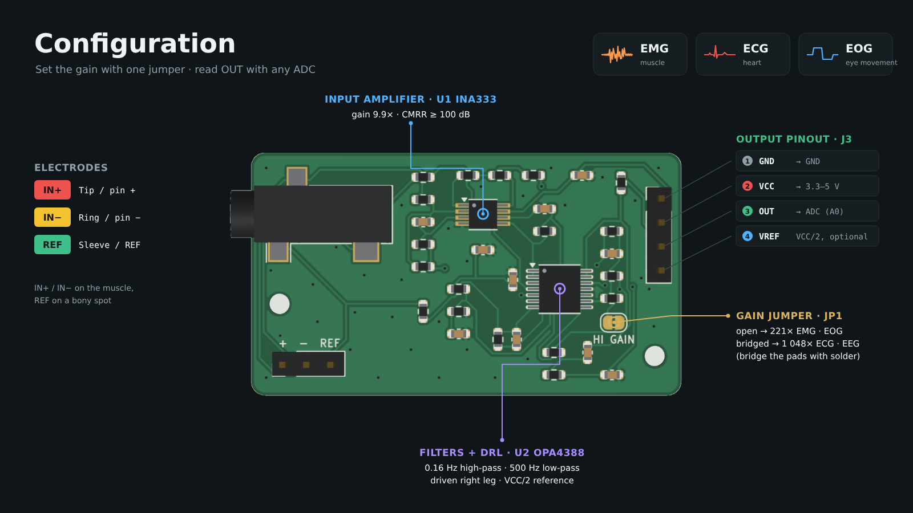
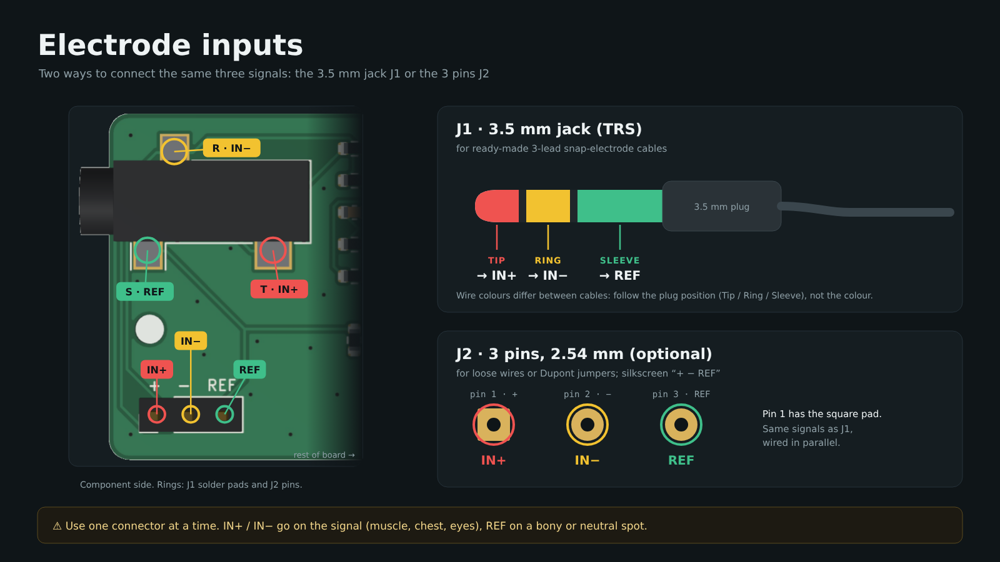
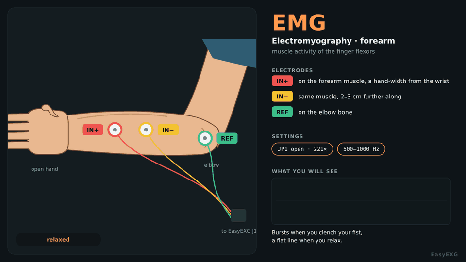
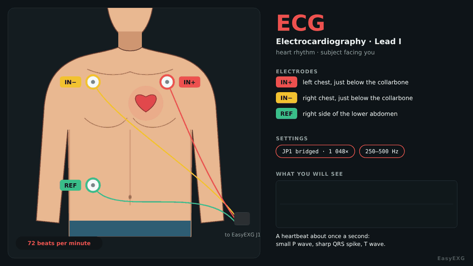
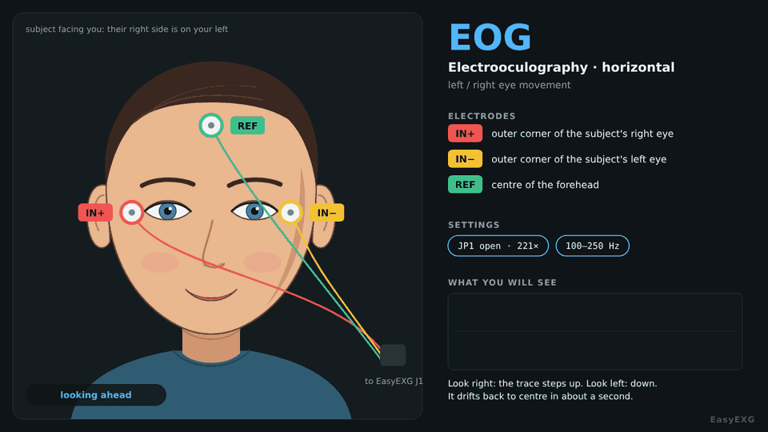
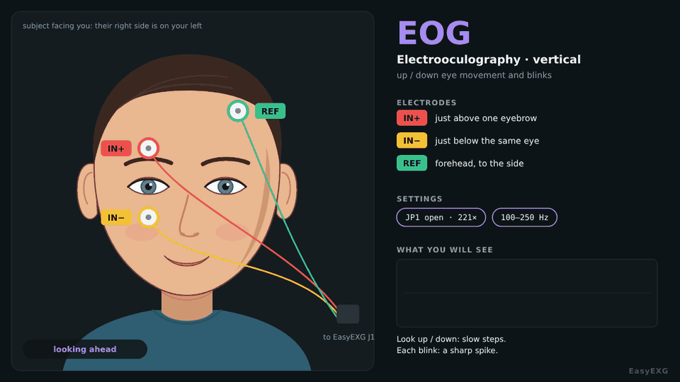
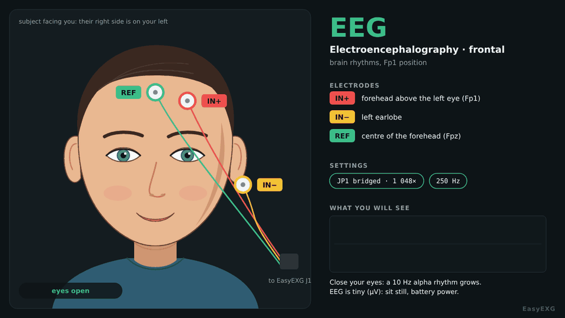

# EasyEXG

EasyEXG is a small analog front end for recording **EMG** (muscle), **ECG** (heart) and **EOG** (eye movement) signals
with any microcontroller ADC (Arduino, ESP32, STM32, Raspberry Pi Pico with an ADC, …).
It runs from **3.3 V or 5 V** and outputs one analog signal centred at VCC / 2.

  

## Board at a glance

  

*3D model of the board (revision EXG-Front v1) with the main dimensions. Orange lines are dimensions in mm.*

What you see in the picture:

| Label | Part | What it does |
|---|---|---|
| **J1** | 3.5 mm audio jack (CUI SJ-3523-SMT) | Plug for a standard 3-lead snap-electrode cable: Tip = IN+, Ring = IN−, Sleeve = REF/DRL |
| **J2** | 3-pin header, 2.54 mm (optional) | Same three electrode signals as J1, for loose wires: + / − / REF. Use J1 **or** J2, not both |
| **U1** | INA333 | Instrumentation amplifier, first gain stage (9.9×) |
| **U2** | OPA4388 | Quad op-amp: mid-supply reference, driven right leg, high-pass + gain, 500 Hz low-pass |
| **JP1** | Solder jumper "HI GAIN" | Open = 221× (EMG, EOG). Bridged with solder = 1 048× (ECG, EEG) |
| **J3** | 4-pin header, 2.54 mm | 1 GND · 2 VCC · 3 OUT (to ADC) · 4 VREF |
| **Ø2.2** | 2 × M2 mounting holes | 40.2 mm apart in X |

| Dimension | Value |
|---|---|
| Board | 46.0 × 26.0 × 1.6 mm, corner radius 1.5 mm, 2-layer FR-4 |
| With jack nose (sticks out 2.0 mm on the left) | 48.0 × 26.0 mm |
| Mounting holes | 2 × Ø2.2 mm (M2) at (3.0, 16.2) and (43.2, 21.8) mm from the top-left corner |
| Height: ICs / jack / pin headers | ≈ 1.2 mm / ≈ 5.0 mm / 8.5 mm above the board |
| Bottom side | no components |

Jack and header heights are typical catalogue values; check them against the parts you buy before designing an enclosure.

## Connection and configuration

| Connection | Configuration |
|:---:|:---:|
|  |  |

- **Connection:** electrodes go to the 3.5 mm jack **J1** (Tip = IN+, Ring = IN−, Sleeve = REF) or to the 3-pin header **J2**.
  The output header **J3** carries GND · VCC · OUT · VREF; connect OUT to your microcontroller's ADC.
- **Configuration:** one solder jumper, **JP1 "HI GAIN"**, sets the gain: open = **221×** (EMG, EOG), bridged = **1 048×** (ECG, EEG).

## Electrode inputs

  

Both connectors carry the same three signals; use **one at a time**.

| Signal | J1 · 3.5 mm jack | J2 · 3 pins (silkscreen) |
|:---:|:---:|:---:|
| **IN+** | Tip | pin 1 · "+" (square pad) |
| **IN−** | Ring | pin 2 · "−" |
| **REF** | Sleeve | pin 3 · "REF" |

Wire colours differ between electrode cables, so follow the plug position (Tip / Ring / Sleeve), not the colour.

## Applications

Each animation shows where to place the three electrodes and the signal you should see.
Electrode colours: **IN+** red · **IN−** yellow · **REF** green.

| Muscle (EMG) | Heart (ECG) |
|:---:|:---:|
|  |  |
| **Eye, horizontal (EOG)** | **Eye, vertical (EOG)** |
|  |  |

**Brain (EEG)**

  

| Signal | JP1 | Electrodes | Sample rate |
|---|---|---|---|
| EMG (forearm) | open · 221× | IN+ / IN− on the muscle 2–3 cm apart, REF on the elbow | 500–1000 Hz |
| ECG (Lead I) | bridged · 1 048× | IN+ left chest, IN− right chest, REF right lower abdomen | 250–500 Hz |
| EOG horizontal | open · 221× | outer corners of both eyes, REF on the forehead | 100–250 Hz |
| EOG vertical | open · 221× | above and below one eye, REF on the forehead | 100–250 Hz |
| EEG (Fp1) | bridged · 1 048× | IN+ forehead above the left eye, IN− left earlobe, REF mid-forehead | 250 Hz |

*The waveforms in the animations are illustrations of typical signals, not recordings.*

## How to start (Arduino)

The animation shows the four steps: wiring, electrodes, uploading the sketch, and reading the signal.

  

| EasyEXG pin (J3) | Arduino pin | Wire colour in the animation |
|:---:|:---:|:---:|
| GND | GND | grey |
| VCC | 5V (or 3.3V) | red |
| OUT | A0 | yellow |
| VREF | not connected | — |

1. **Wire J3 to the Arduino** with 3 jumper wires: **GND → GND**, **VCC → 5V**, **OUT → A0**. Leave VREF unconnected.
2. **Place the electrodes** (EMG on the forearm): IN+ and IN− on the muscle, 2–3 cm apart, and REF on a bony spot such as the elbow.
   Plug the electrode cable into the 3.5 mm jack J1. Leave JP1 open for EMG; bridge it for ECG.
3. **Upload the sketch** [`EasyEXG_Arduino.ino`](Arduino/EasyEXG_Arduino/EasyEXG_Arduino.ino) with the Arduino IDE.
4. **Open Tools → Serial Plotter** at **115200 baud** and clench your fist. You will see bursts on the blue trace (signal)
   and a rising yellow trace (envelope); when you relax, both go flat.

> ⚠️ Power the Arduino from a laptop running on battery (charger unplugged) while electrodes are on a person.

## Amplifier design and verification

The amplifier chain was simulated in ngspice with a 10 MHz op-amp model (OPA4388).

  

*Simulated total gain versus frequency. Blue: JP1 open (221×, for EMG and EOG). Green: JP1 bridged (1 048×, for ECG and EEG).
Shaded areas mark the ECG band (0.5–40 Hz) and the EMG band (20–450 Hz). The gain is flat from 0.16 Hz to 500 Hz
(dotted lines mark the −3 dB points) and rolls off steeply above 500 Hz.*

### Signal chain

| Stage | Part | Function | Gain |
|---|---|---|---|
| 1 | INA333 (U1) | Instrumentation amplifier, G = 1 + 100 kΩ / 11.2 kΩ | 9.9× |
| 2 | OPA4388 (U2C) | 0.16 Hz high-pass + non-inverting gain (JP1 selects gain) | 22× / 106× |
| 3 | OPA4388 (U2D) | 500 Hz 2nd-order Sallen-Key low-pass (Q = 0.73) | 1× |
| — | OPA4388 (U2A) | Mid-supply reference VREF = VCC / 2 | — |
| — | OPA4388 (U2B) | Driven right leg (DRL), 390 kΩ current limit | — |

### Gain and bandwidth

| JP1 | Use | Total gain | Band (−3 dB) | Max input before clipping (5 V / 3.3 V) |
|---|---|---|---|---|
| Open | EMG, EOG | **221×** | 0.16–501 Hz | 10.9 mV / 7.2 mV |
| Bridged | ECG, EEG | **1 048×** | 0.16–501 Hz | 2.3 mV / 1.5 mV |

- ✅ Instrumentation amplifier gain is 9.9×, as designed.
- ✅ The 0.16 Hz high-pass keeps the true ECG shape.
- ✅ The 500 Hz 2nd-order low-pass covers the whole EMG band (20–450 Hz) and removes noise above it.
- ✅ The INA333 rejects mains hum with CMRR ≥ 100 dB.
- ✅ The DRL loop is stable, with at most 2 dB of peaking (around 1.3–1.5 kHz).

### Design note: R8 = 10 MΩ

R8 (DRL feedback resistor) is **10 MΩ** (Yageo RC0603FR-0710ML, the same part as R3 and R4).
With 1 MΩ the right-leg drive is too weak: simulated 50 Hz common mode at the input is −46.8 dB. With 10 MΩ it
improves to **−55.3 dB**, with peaking still below +2 dB.
R9 stays at 390 kΩ, which limits the current into the body to about 13 µA at 5 V.

## Operating notes

- Supply: 3.3 V or 5 V (absolute max 5.5 V). OUT rests at VCC / 2 with no signal.
- Sample EMG at ≥ 1 kHz, ECG/EOG at ≥ 250 Hz.
- Electrodes (3.5 mm jack): Tip = IN+, Ring = IN−, Sleeve = REF/DRL.
- Power from a battery or an isolated USB supply while electrodes are on a person.

> Simulations use idealised electrode (51 kΩ ∥ 47 nF) and body (200 pF mains coupling) models, so real hum levels
> will differ. This is a hobby / research board, not a medical device.

> [!WARNING]
> EasyEXG is **not a medical device** and has not been certified by any regulator for use with the human body. It is a tool for research, education and engineering. You use it at your own risk.

> [!CAUTION]
> **Battery only.** EasyEXG and everything cabled to them (Arduino board etc) must run from a **5 V power bank** while electrodes are on a person. Never use a wall charger or a mains-powered monitor or computer. The board has **no isolation**. Read the [Safety page](https://docs.pieeg.com/hardware/devices/pieeg-8/safety/) and the [liability notice](https://pieeg.com/liability/).

## License

Project: **CC BY-NC 4.0 (Creative Commons Attribution–NonCommercial)**. Hardware use is subject to the BY-NC 4.0 Licence and the [PiEEG liability notice](https://pieeg.com/liability/).

## Contact

- 🌐 [pieeg.com](https://pieeg.com/)
- 📖 [docs.pieeg.com](https://docs.pieeg.com/)
- 💬 [Discord](https://discord.gg/5Ps24p47)
- ✉️ [pieeg@pieeg.com](mailto:pieeg@pieeg.com)

